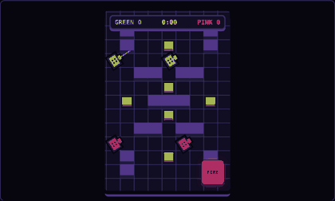

# Layers: a game is a stack

A landing-page story graphic. A Battlefield Blitz-style board plays, turns and fans out into its
eight layers (real DOM layers in CSS 3D), each labelled with the bytes Blitz's own code spends on
it. The collision layer faults red, a scan patches it, it flashes green, and the stack folds back
into the game. It wears the Board UI kit (`src/ui`, from DOM Battlefield): every colour is a kit
token, the on-screen control is the kit's arcade fire key, and the figure is a `.bui` root, so the
host page loads `board-ui.css`. It plays on its own, with a play/pause key; scrolling or swiping
over it fans the layers out by hand ("Scroll me to fan the layers"). By [Chris Cooley](https://coded.design/).



- Source: [`site/demos/layers/`](../../site/demos/layers/) (`scene.ts` the scene, `poster.ts` the
  slot markup, still poster and inline loader, `entry.ts` the live chunk's entry, `data.ts` the
  layers and bytes).
- Build: `node site/demos/layers/build.mjs [outDir]` (default `site-dist/demos/layers/`). This page
  template is `page.mjs`.
- Measure: `node site/demos/layers/measure.mjs` writes `site/demos/layers/measured.json`; the
  caption prints only those numbers.
- Test: `npm run test:layers` (mounts and autoplays, the play key, stops off screen, Recall is exact;
  the scroll lock by wheel and by swipe; labels never collide; the keys; reduced motion; no JS before
  the slot is near; the hero budgets).

## Embed it

```html
<!-- poster(): the slot figure with its poster, play key and cue inline; POSTER_CSS in a <style> -->
<figure class="ae-slot lyr bui" data-slot-target="index#layers" aria-label="The layers story" aria-describedby="lyr-d">…</figure>
<!-- loader("demos/layers/layers.js"): ~370 B inline; it holds a wheel over the figure and imports
     the live chunk when the slot is near -->
<script type="module">…</script>
```

## Behaviour

- **Plays on its own:** the story runs three times round while the figure is on screen, then rests
  on the game frame and the kernel settles. The play/pause key
  (the kit's arcade key, `go`) stops and resumes it from the same frame.
- **Scroll lock, like every demo frame on the site:** a wheel or a vertical swipe over the figure
  steps the story by hand instead of moving the page (down fans the layers out, up folds them back;
  90 px a story second) and pauses the autoplay. The figure takes the kit's touch lock
  (`touch-action: none`, `overscroll-behavior: none`) and cancels the wheel, from the inline script
  before the scene is there and from the scene after. The cue under the stack says so ("Scroll me to
  fan the layers", "Swipe…" on touch) until it is used; the site's scroll-lock note
  (`site/scroll-hint.ts`) turns the frame red and says why. Off the figure the page scrolls as ever.
  The standalone page has no site script, so it loads the note's own chunk (`hint.js`) with the scene.
- **Keys:** the figure takes focus; the arrows step one stop at a time (each label, then the fault,
  the scan and the patch), Home and End go to the ends. Tab then reaches the play key.
- **Lazy:** no JS file loads up front. A ~370 B inline script imports `layers.js` (`@fzlt/core/slot` and
  the scene, one file) when the slot comes within 200px, is tapped or takes focus; the slot then
  waits for an idle main thread and mounts the scene.
- **Calm:** 30 fps cap. Paused, or off screen, it settles (no `requestAnimationFrame` at all).
- **Labels:** each arrives with its layer, never while it moves; the exploded gap widens on narrow
  slots to keep a 28px label pitch, and the scene measures its widest label at mount, so labels never
  overlap, clip or smear (`npm run test:layers` checks the whole story at 390 and 1440).
- **Reduced motion:** the scene never loads; no lock, no play key, no cue; the poster shows the
  still exploded view with every label (CSS only, sized by container queries).
- **Accessible:** the figure is labelled "The layers story" and described (`aria-describedby`) by a
  visually hidden paragraph that tells the whole sequence and how to drive it; the picture itself is
  `aria-hidden`; the play key is a real, labelled button.
- **Recall:** `destroy()` gives the page back exactly (the play key back to Play).

## Measured

See `site/demos/layers/measured.json`. On Fizlet 0.21.1, Chromium 153: live chunk 8,060 B gzip
(`@fzlt/core/slot` + scene, loaded only once the slot is near); poster, controls and inline script
4,057 B gzip (script 368 B); at 4× CPU throttle over one whole loop, script per frame 1.2 ms median,
3.3 ms p95, 5.8 ms max; layout shift 0; 0 frames while paused; 0 B of JS fetched before the slot
nears the viewport.

Against the hero budgets in fizlet-engine `docs/LAYERS.md`: live chunk ≥ 5% under 10 KB ✔, poster ≤ 6 KB ✔,
0 B JS before the slot is near ✔, CLS 0 ✔, 0 frames paused ✔. `npm run test:layers` fails the
build if the live chunk or the poster goes over.

How it fits: the tanks patrol fixed loops (the dotted rectangles on the movement layer), so the hero
carries no path search and no `@fzlt/core/grid` (−1.5 KB); slot and scene ship as one file loaded by the
inline loader; the scene's state styles live in the page CSS; the stack's bounds are precomputed
(`build.mjs` checks them against the formula). Bricks in the live chunk: kernel, slot, sprite, fx.
